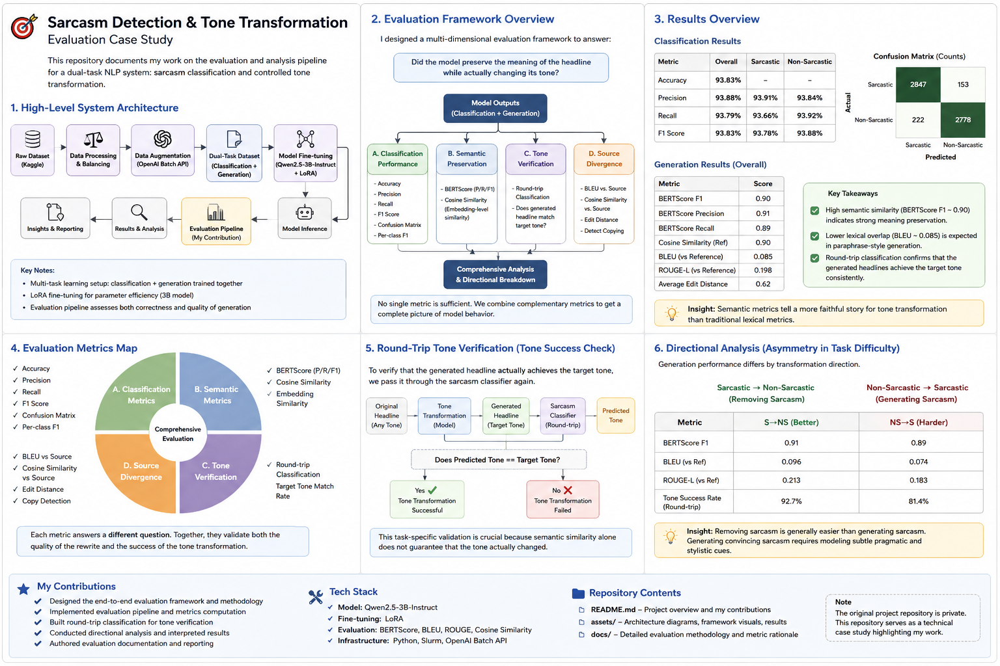

# Sarcasm NLP Portfolio

An NLP project exploring **sarcasm classification and controlled tone transformation** using a parameter-efficiently fine-tuned large language model.

This project was developed as part of a team project for **CS4248 Natural Language Processing at the National University of Singapore**.

My primary responsibility was the **evaluation and analysis workstream**: designing and implementing the framework used to determine not only whether the model produced linguistically similar outputs, but whether the transformations actually achieved the intended change in tone.

> **Note:** The original project repository is private. This repository serves as a technical case study documenting the system architecture, my contributions, evaluation methodology, and key findings.

---

## Project Overview

The project addresses two related NLP tasks:

### 1. Sarcasm Classification

Given a news-style headline, predict whether it is:

* Sarcastic
* Non-sarcastic

### 2. Tone Transformation

Rewrite a headline while preserving its underlying meaning but changing its tone:

* Sarcastic → Non-sarcastic
* Non-sarcastic → Sarcastic

The project uses **Qwen2.5-3B-Instruct**, fine-tuned using **LoRA (Low-Rank Adaptation)** in a multi-task learning setup.

---

## Project Architecture & Evaluation Overview

The diagram below gives an overview of the project pipeline, evaluation framework, key results, and my main contributions.



---

## System Architecture

```text
Raw Dataset
      │
      ▼
Data Processing & Balancing
      │
      ▼
Data Augmentation
      │
      ▼
Dual-Task Dataset
 ┌──────────────┬───────────────┐
 │Classification│  Generation   │
 └──────┬───────┴───────┬───────┘
        │               │
        └───────┬───────┘
                ▼
       Qwen2.5-3B-Instruct
          + LoRA Fine-tuning
                │
                ▼
        Model Predictions
                │
                ▼
        Evaluation Pipeline
                │
        ┌───────┼─────────┐
        ▼       ▼         ▼
 Classification Semantic  Tone
   Metrics      Metrics Verification
        │       │         │
        └───────┼─────────┘
                ▼
        Results & Analysis
```

---

# My Contribution — Model Evaluation

I **owned the evaluation and results-analysis component** of the project.

A major challenge was that evaluating text generation is significantly more complicated than evaluating classification.

For classification, metrics such as accuracy and F1 provide clear measures of performance.

For tone transformation, however, there can be many valid rewrites of the same sentence. A generated sentence may be completely different from the reference at the word level while still being semantically correct.

Because of this, I designed a **multi-dimensional evaluation framework** rather than relying on a single metric.

---

## Evaluation Framework

I evaluated generated outputs across four major dimensions.

### 1. Classification Performance

For sarcasm detection, I evaluated:

* Accuracy
* Precision
* Recall
* F1 score
* Per-class performance
* Confusion matrix

The model achieved approximately:

**93.83% classification accuracy**

with similarly strong F1 performance across both classes.

This was important because it demonstrated that the model was not achieving high overall accuracy by disproportionately favouring one class.

---

### 2. Semantic Preservation

A successful tone transformation should modify the tone without changing the underlying meaning.

I therefore evaluated generated outputs using semantic similarity metrics including:

* **BERTScore**
* **Cosine similarity**

The model achieved a **BERTScore F1 of approximately 0.90**, indicating strong semantic preservation despite substantial surface-level rewriting.

---

### 3. Lexical Similarity

Traditional generation metrics were also included:

* BLEU
* ROUGE

However, these metrics were deliberately interpreted alongside semantic measures rather than used independently.

For example, the model produced a relatively low BLEU score while maintaining a high BERTScore.

This illustrated an important characteristic of paraphrase-style NLP evaluation:

> A generated output can differ significantly in wording while still preserving the intended meaning.

Rather than treating the low lexical overlap as model failure, I used multiple evaluation signals to distinguish legitimate rewriting from incorrect generation.

---

### 4. Tone Verification

Semantic similarity alone does not prove that the model completed the actual task.

For example, a model could generate a sentence that preserves the original meaning extremely well while failing to change its sarcasm.

To address this, I implemented **round-trip classification**.

```text
Original Headline
       │
       ▼
Tone Transformation
       │
       ▼
Generated Headline
       │
       ▼
Sarcasm Classifier
       │
       ▼
Does predicted tone match
the requested target tone?
```

The generated headline is passed back through the sarcasm classifier.

This provides an additional task-specific validation signal indicating whether the transformation actually changed the tone in the intended direction.

This was particularly useful because conventional generation metrics such as BLEU, ROUGE, or BERTScore cannot directly determine whether sarcasm has been successfully introduced or removed.

---

## Detecting Degenerate Model Behaviour

Another evaluation challenge was distinguishing genuine rewriting from trivial solutions.

For example, a model could preserve semantic meaning simply by returning the original sentence unchanged.

To identify this behaviour, I incorporated **source-divergence measurements**, comparing generated outputs against both:

1. The reference transformation
2. The original source sentence

This allowed us to distinguish between:

```text
Meaning preserved + sentence transformed
                ✓

Meaning preserved + source copied
                ✗
```

Metrics such as edit distance and source similarity helped determine whether the model was performing a meaningful transformation rather than simply copying its input.

---

## Direction-Specific Analysis

I also separated evaluation results according to transformation direction:

```text
Sarcastic → Non-sarcastic

Non-sarcastic → Sarcastic
```

This revealed that the two directions were not equally difficult.

The model generally performed better when **removing sarcasm** than when **generating sarcasm**.

For example, lexical similarity scores were stronger for sarcasm removal than sarcasm generation.

This suggests that generating sarcasm requires modelling additional linguistic and pragmatic information rather than simply rewriting surface-level wording.

The directional analysis helped expose behaviour that would have been hidden by reporting only a single aggregate generation score.

---

# Why Multiple Metrics Were Necessary

One of the main conclusions from my evaluation work was that **no individual metric adequately captures the quality of a controlled text transformation system**.

For example:

```text
High semantic similarity
        +
Low tone-change accuracy
        =
Meaning preserved,
but transformation failed
```

Similarly:

```text
Low BLEU
        +
High BERTScore
        +
Successful tone change
        =
Potentially valid paraphrase
despite low lexical overlap
```

The final evaluation framework therefore combines:

| Dimension                 | Purpose                                 |
| ------------------------- | --------------------------------------- |
| Classification metrics    | Measure sarcasm detection               |
| BERTScore                 | Measure semantic similarity             |
| Cosine similarity         | Measure representation-level similarity |
| BLEU / ROUGE              | Measure lexical overlap                 |
| Round-trip classification | Verify target tone                      |
| Source divergence         | Detect copying                          |
| Direction-level analysis  | Identify task asymmetry                 |

Together, these metrics provide a more complete representation of model behaviour than any individual metric.

---

# Key Results

### Sarcasm Classification

**Accuracy:** 93.83%

**F1:** ~0.94

Performance remained approximately balanced between sarcastic and non-sarcastic classes.

### Tone Transformation

**BERTScore F1:** ~0.90

The relatively high semantic similarity indicated that the model generally preserved the meaning of headlines during transformation.

At the same time, lexical metrics were substantially lower, demonstrating that the model was often performing meaningful paraphrasing rather than reproducing the reference wording exactly.

### Directional Behaviour

Evaluation also revealed measurable differences between transformation directions.

Sarcasm removal generally performed better than sarcasm generation, suggesting that producing convincing sarcastic language represents the more difficult generation task.

---

# Technical Stack

| Area              | Technology                                |
| ----------------- | ----------------------------------------- |
| Language Model    | Qwen2.5-3B-Instruct                       |
| Fine-tuning       | LoRA                                      |
| ML / NLP          | Python                                    |
| Evaluation        | BERTScore, BLEU, ROUGE, cosine similarity |
| Data Augmentation | OpenAI Batch API                          |
| Compute           | Slurm-based compute cluster               |
| Experimentation   | Jupyter Notebook                          |
| Automation        | Python + Shell                            |

---

# What I Learned

The most important lesson from this project was that **model evaluation needs to reflect the actual objective of the task**.

A single high metric can be misleading.

For controlled text generation, I found that meaningful evaluation requires answering several separate questions:

* Did the model preserve the original meaning?
* Did it actually modify the requested linguistic property?
* Did it generate new text rather than copy the input?
* Does performance differ depending on transformation direction?
* Are lexical and semantic metrics telling the same story?

Designing the evaluation around these questions gave us considerably more insight into model behaviour than reporting conventional generation metrics alone.

---

## My Responsibilities

My primary contributions to the group project included:

* Designed the **end-to-end evaluation methodology** for classification and generation
* Implemented the model **evaluation and metrics pipeline**
* Integrated classification, semantic, lexical, and source-divergence metrics
* Implemented **round-trip classification** to verify tone transformations
* Developed direction-specific analysis for both transformation directions
* Analysed model outputs and identified key failure patterns and task asymmetries
* Interpreted experimental results and translated metrics into model-level insights
* Authored the project's **evaluation documentation**, including metric rationale and interpretation

---

## Key Takeaway

Rather than treating evaluation as simply reporting an accuracy or BLEU score, my work focused on building an evaluation framework capable of answering:

> **Did the model preserve what the headline means while actually changing how it communicates that meaning?**

That distinction became central to understanding the real performance of the system.

